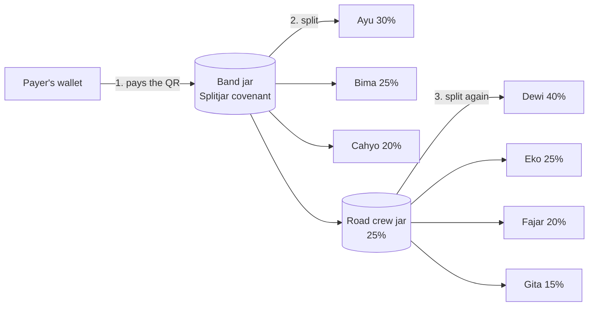

<div align="center">


# Splitjar

**A Bitcoin Cash address that pays a whole team.**

One QR. Everyone gets paid.

[](https://github.com/Stylenexy/splitjar/actions/workflows/ci.yml)    [](#embed-and-badge)

**Live app: _TODO final URL_** · **[Play-money jar, no wallet needed](#try-it-in-60-seconds)** · **Slides (Widget Factory): _TODO_** · **Video: _TODO_**

</div>

Splitjar turns one Bitcoin Cash QR into a whole team: pay once, and a CashScript covenant pays every member their share within seconds. No treasurer, and no way to change the cut. A member can itself be another team's Splitjar, so one payment can flow down a revenue waterfall (organiser, band, crew) in consecutive transactions.

Built for **BCH BLAZE 2026, Mainnet Track**, November 2026. The contract has not been audited: use small amounts.


## Try it in 60 seconds

1. **No wallet, no money.** Open the app's `/try` page and press *Pay 0.001 BCH into the jar*. The page runs the real contract against an in-memory network: each split transaction is built by CashScript and accepted by the Bitcoin Cash VM (libauth) in your tab. The sample band jar pays three players and the road crew's own jar, which splits again: **one payment, two levels, seven wallets, two transactions.**
2. **Cheat it.** Press *Pay 0.001 BCH and let the thief try first*. Before the honest split, the page broadcasts a transaction that sends the whole payment to the first member. The VM refuses it. The page shows the raw refusal and the contract line that caught it (`Splitjar.cash` line 32, *one output per member, no extra outputs*). Then the honest split goes through. On mainnet the same button sends the cheat to a real node.
3. **Real mainnet.** Make a jar at `/new` with **Test with two of my own addresses** (the money comes back to you), or pay into the demo jar (_TODO: mainnet demo jar link once its addresses are set_). Scan the QR with any Bitcoin Cash wallet, or press **Pay with WizardConnect** and approve in your wallet. Within a couple of seconds the split goes out; each line of the tree links to its transaction on the explorer. Close the tab and pay from your phone: the keeper still sends the split.

## For judges: how each Mainnet Track requirement is met

| Requirement | How Splitjar meets it | Where to check |
|---|---|---|
| Anyone can make a useful BCH mainnet transaction with the app | Pay into a jar from any wallet (BIP21 QR) or through WizardConnect; the app then broadcasts the split, a second mainnet transaction with one output per member, and one more per nested jar | [`PayPanel.tsx`](src/components/PayPanel.tsx), [`engine.ts`](src/lib/engine.ts). Mainnet transaction ids: **TODO** (added after the first funded run) |
| WizardConnect integration | `@wizardconnect/react` 0.2.6 pairs a wallet over the relay; the app derives the wallet's addresses from the shared xpubs, finds its coins, builds the payment with CashScript and asks the wallet to sign it with `inputPaths` | [`wallet.ts`](src/lib/wallet.ts), [`PayPanel.tsx`](src/components/PayPanel.tsx). Wallets tested: **TODO** (Selene, Paytaca, Cashonize) |
| Live demo a judge can open with one link | Static site, no account, no backend | **TODO final URL** |
| Banner on top of the home page: slides, repo, EMBER2026 address | Strip above the navigation, filled from one config file | [`Chrome.tsx`](src/components/Chrome.tsx) `Banner`, values in [`site.ts`](src/site.ts) (**slides link and EMBER2026 address: TODO**) |
| Original work | Written from scratch during the hackathon; first commit 17 November 2026 (`git log --reverse`). Prior concept work is listed under [Credits](#credits--prior-work) | git history |

## How it maps to the judging criteria

| Criterion | What Splitjar does |
|---|---|
| **Innovation** | An address that is a whole team. Nested jars make a revenue waterfall out of plain payments: a festival pays a band, the band pays its crew, all from one scan. The page invites you to attack it and shows the network refusing. |
| **Design and usability** | The payer only scans and pays. The team sets up in one form, no account; nesting is pasting another jar's link as a member. The split tree lights up level by level with the amount and a link per transaction. Tested at 360 px. (The visual design is a neutral placeholder while the final direction is chosen.) |
| **Technical strength** | Covenant with native introspection: output count, recipients, exact amounts and token fields are all fixed by the contract; no owner key, no signature. Nested jars need no contract change: a jar's address is a P2SH32 locking bytecode like any other recipient. Splits are deterministic, so any device (or the keeper) can send them and all send the same transaction. 35 tests, all transactions checked by the BCH VM. |
| **Business potential** | See [Business model](#business-model-and-roadmap): an optional organiser share in event jars, printed QR kits, and a one-line embed for podcasts, restaurants and team fundraisers. |

## How it works



1. **The team writes down who gets what.** Names, payout addresses and shares (2 to 4 members, adding up to 100%). A member can be another jar: paste that jar's link instead of an address. The list is encoded in the page link after the `#`, so it never reaches a server. The browser instantiates the precompiled contract with these values and gets a P2SH32 address.
2. **Someone pays the QR**, a BIP21 `bitcoincash:` URI, from any wallet, or through WizardConnect.
3. **The split goes out.** A page with the jar open polls the jar addresses every 1.5 s through an Electrum server. When a coin arrives it builds `distribute()`: one input (the payment), one output per member, amounts computed exactly as the contract computes them. If a member is a jar, the page immediately splits that jar too, spending the output it just created. Each split's 1,000-sat fee comes out of the money it splits, so nobody needs a wallet to send it.
4. **No page open?** `splitjar-keeper` does step 3 from a terminal or a schedule ([Keeper](#keeper-members-get-paid-with-the-tab-closed)).

The contract does not split on arrival (Bitcoin Cash has no such hook); it makes the split the only way the coin can ever move.

## The contract

[`contracts/Splitjar.cash`](contracts/Splitjar.cash), 89 lines, CashScript 0.14.0, 158 opcodes.

- Constructor (line 9): four locking bytecodes (P2PKH wallets or P2SH32 jars), shares of the first three members in basis points, member count, fee. The last member gets the remainder, so shares always cover the whole pot.
- `distribute()` (line 27): exactly one input and `members` outputs (lines 31-32); `pot = input - fee` (line 34); each output must pay the right locking bytecode exactly `floor(pot * bps / 10000)`, at least 1,000 sats, no tokens (lines 36-73). Integer division floors and the last member takes what is left, so rounding never loses a satoshi.
- `merge()` (line 79): joins two coins that are each too small to split. The only output is the jar itself, with the sum minus the fee.

Measured split sizes: 441 bytes for 2 members, 502 for 3, 561 for 4, so the fixed 1,000-sat fee pays 1.8 to 2.3 sat/byte, above the 1 sat/byte relay minimum. A jar refuses a share that the next level could not split: the app computes the minimum payment per level (fee plus 1,000 sats per wallet, recursively) and shows it on each jar page.

**Code map.** Jar config, URL encoding, nesting rules and the split arithmetic: [`jar.ts`](src/lib/jar.ts) (`splitPot` line 56, `minPaymentFor` line 92, `validateJar` line 169). Contract, nesting and transactions: [`chain.ts`](src/lib/chain.ts) (`resolveJar` line 62, `jarTree` line 83, `buildDistribute` line 123, `buildCheat` line 145, `explainCheat` line 156). The watcher and the cascade: [`engine.ts`](src/lib/engine.ts) (`JarEngine` line 77, `once` line 155, `split` line 251). WizardConnect payment: [`wallet.ts`](src/lib/wallet.ts) (`payWithWallet` line 62). Keeper: [`keeper/cli.ts`](keeper/cli.ts).

## Tests

```bash
npm ci
npm test        # compiles the contract, then 35 tests
npm run build   # type-check and production build
```

Every transaction in the tests goes through CashScript's `MockNetworkProvider`, which evaluates it with the Bitcoin Cash VM against the real locking bytecode, like a node.

- [`test/splitjar.test.ts`](test/splitjar.test.ts): pays 2, 3 and 4 members their exact shares, fee exactly 1,000 sats and at least 1 sat/byte; rounding (123,457 sats at 33.33/33.33/33.34% gives 40,814 + 40,814 + 40,829); the same split on two devices has the same txid; refuses the whole pot to one member, a redirected output, swapped amounts, a bigger fee, an extra output, two payments at once, a payout under 1,000 sats, a merge that leaves the jar or skims. **Split trees:** the band jar pays the crew jar at its P2SH32 locking bytecode (`aa20…87`), the crew jar splits again, seven wallets receive `payment − 2 × fee`; refuses paying the crew's share to a wallet instead; a three-level waterfall (organiser, band, crew) delivers `payment − 3 × fee`.
- [`test/engine.test.ts`](test/engine.test.ts): the watcher splits a payment and then the nested jar on its own (one payment, two levels, seven wallets); the thief goes first, is refused, and the refusal names the contract rule.
- [`test/jar.test.ts`](test/jar.test.ts): jar links (round trip, nested, broken links), validation (wrong network, address typos, duplicates, shares, three levels allowed and a fourth refused), minimum payments for nested jars.

## Keeper: members get paid with the tab closed

```bash
npm run keeper -- "https://<site>/jar#<code>"            # one round, then exit
npm run keeper -- --file keeper/jars.txt                  # every jar listed in the file
npm run keeper -- --watch --every 30 "https://<site>/jar#<code>"
```

The keeper looks at every jar in the tree once, sends the split for anything waiting (and the nested splits after it), and prints the transactions. It holds no keys: the covenant only allows the honest split and pays its own fee. [`.github/workflows/keeper.yml`](.github/workflows/keeper.yml) runs it every 5 minutes for the jars in [`keeper/jars.txt`](keeper/jars.txt) once the repository variable `KEEPER_ENABLED` is `true`. The package declares a `splitjar-keeper` bin; it is not published to npm yet, so run it from a clone.

Honest timing: with the jar page open the split follows the payment within seconds; with every page closed it waits for the keeper's next round (up to about 5 minutes on the schedule, GitHub cron is best effort).

## Embed and badge

One line puts a "Pay this team on BCH" button on any page (a podcast site, a menu, a campaign page):

```html
<script src="https://<site>/embed.js" data-jar="https://<site>/jar#<code>" data-label="Tip the show"></script>
```

For a README: `[](https://<site>/jar#<code>)`.

The SDK entry point [`src/sdk.ts`](src/sdk.ts) exports what the site and the keeper use: decode a jar link, get its address, build or send its splits.

## Security and honest limits

- **Not audited.** Built in a hackathon week. Use small amounts.
- **Someone has to send the split.** The contract only allows it. A page with the jar open does it within seconds, the keeper on its schedule, anyone else at any time; they all send the same transaction. Until then the coin waits in the jar, safe.
- **Nested jars cost one fee per level** (1,000 sats each) and a jar refuses a share too small for its nested jar to split again. Three levels at most in the app; the contract itself does not limit depth.
- **Merge griefing is bounded.** Anyone may merge two coins in a jar; each merge costs the team 1,000 sats and never moves money out. With *n* coins there can be at most *n − 1* merges.
- **Tokens are not supported.** The app shows only the plain address. CashTokens sent to a jar anyway are burned when the coin is split.
- **The jar link is public information**: it lists the members' payout addresses and shares, as does the chain after the first split.
- **WizardConnect coin discovery** checks the first 12 receive and 12 change addresses of the connected wallet.
- **Fixed fee.** 1,000 sats per split. If relay fee policy rose above about 1.7 sat/byte, a new contract version with a higher fee would be needed for 4-member jars.
- **Not yet done (before submission):** mainnet transaction ids, WizardConnect pairing tested with Selene, Paytaca and Cashonize, final URL, slides, EMBER2026 address.

## Business model and roadmap

- **Free core.** Making a jar and paying into it stays free. The contract has no owner key and takes no cut.
- **Event jars:** an organiser share written into a festival jar, so every act sees it before agreeing; each act's share goes to the act's own jar.
- **Embed for teams that already take BCH:** podcasts with several hosts, restaurant tip pools, team-run FundMe campaigns. One line of HTML, no backend.
- **Printed kits:** a QR card and sticker for a guitar case or a till.
- **Roadmap:** keeper as a hosted service with notifications, shares shown in fiat at payment time, Indonesian interface, a tip to Splitjar itself split with a BCH open-source fund.

## Run it locally

Requires Node 22+.

```bash
npm ci
npm run dev       # http://localhost:5173
```

`npm run compile` rebuilds `src/contract/splitjar.artifact.ts` from `contracts/Splitjar.cash` (also run by `dev`, `build` and `test`). Icons come from `public/favicon.svg` (`scripts/icons.mjs`); the share image from `scripts/og.html`.

## Credits & prior work

- **Where the idea comes from.** In Indonesia, street bands pass a *kencleng* (a tip can with a slot in the lid) around after a set, and one person ends up holding it and paying the others. Splitjar's first working name was Kencleng.
- **Prior concept by the same author:** BonBagi (ZECATHON 2026, Zcash shielded payments, October 2026) split one payment across members with a signed agreement and a multi-recipient Zcash request. Splitjar shares no code, text or assets with it: the contract, the app and the design were written from scratch for Bitcoin Cash during BCH BLAZE 2026.
- Covenants that divide coins between fixed recipients have been discussed in the Bitcoin Cash community before. Splitjar does not claim to be the first; it packages the idea for teams paid by QR, and adds nesting.
- Built with [CashScript](https://cashscript.org) 0.14.0 (MIT), [libauth](https://libauth.org) (MIT), [WizardConnect](https://gitlab.com/riftenlabs/lib/wizardconnect) by Riften Labs (LGPL-3.0-or-later, used unmodified as npm packages), [qrcode](https://github.com/soldair/node-qrcode) (MIT), React and Vite. Fonts: Bricolage Grotesque, Instrument Sans, IBM Plex Mono (SIL Open Font License) via Fontsource.
- Logo and share image: drawn for this project.

License: [MIT](LICENSE).
