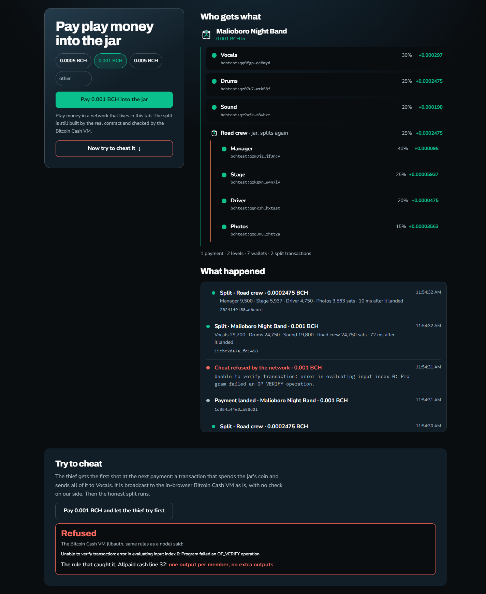
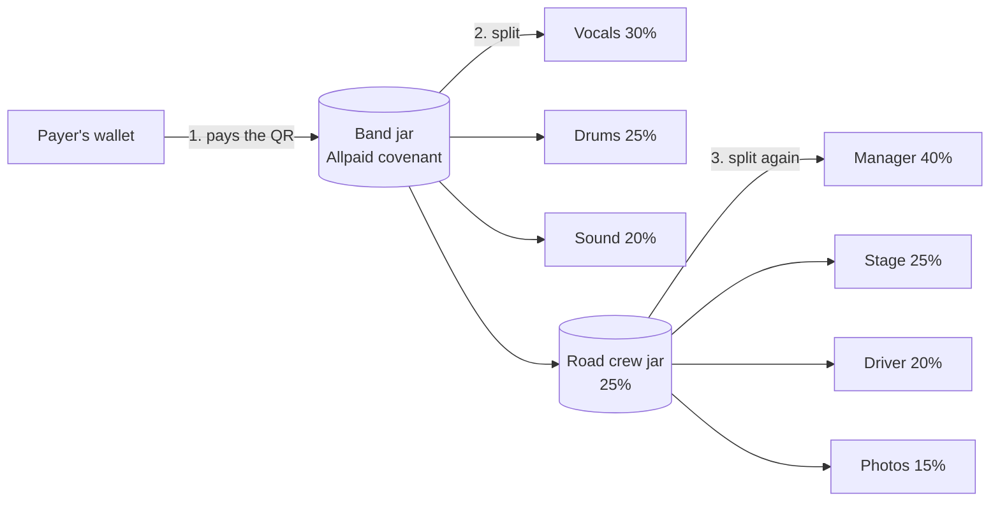

<div align="center">


# Allpaid

**A Bitcoin Cash address that pays a whole team.**

One QR. Everyone gets paid.

[](https://github.com/Stylenexy/allpaid/actions/workflows/ci.yml)    [](#embed-and-badge)

**[Live app](https://allpaid.vercel.app)** · **[Try it, no wallet](https://allpaid.vercel.app/try)** · **[Make a jar](https://allpaid.vercel.app/new)**

</div>

Allpaid turns one Bitcoin Cash QR into a whole team: pay once, and a CashScript covenant pays every member their share within seconds. No treasurer, and no way to change the cut. A member can itself be another team's Allpaid, so one payment can flow down a revenue waterfall (organiser, band, crew) in consecutive transactions.

Built for **BCH BLAZE 2026, Mainnet Track**, November 2026. The contract has not been audited: use small amounts.



## Try it in 60 seconds

1. **No wallet, no money.** Open [allpaid.vercel.app/try](https://allpaid.vercel.app/try) and press *Pay 0.001 BCH into the jar*. The page runs the real contract against an in-memory network: each split transaction is built by CashScript and accepted by the Bitcoin Cash VM (libauth) in your tab. The sample band jar pays three players and the road crew's own jar, which splits again: **one payment, two levels, seven wallets, two transactions.**
2. **Cheat it, two ways.** Press *Now try to cheat it*, pick a cheat, then *Pay 0.001 BCH and let the thief try first*. Before the honest split, the page broadcasts the thief's transaction: either the whole payment to the first member, or every member paid with the right total but two members' amounts swapped. The VM refuses both. The page shows the raw refusal and the contract line that caught it, with its code: line 32 (*one output per member, no extra outputs*) for the first, line 39 (*output 0 has the wrong amount*) for the swap. Then the honest split goes through. On mainnet or chipnet the same button sends the cheat to a real node.
3. **Real mainnet.** Make a jar at `/new` with **Test with two of my own addresses** (the money comes back to you), or pay into any jar someone shares with you. Scan the QR with any Bitcoin Cash wallet, or press **Pay with WizardConnect** and approve in your wallet. Within a couple of seconds the split goes out; each line of the tree links to its transaction on the explorer. Close the tab and pay from your phone: the payment waits safely in the jar until any jar page or a keeper round sends the split.

## For judges: how each Mainnet Track requirement is met

| Requirement | How Allpaid meets it | Where to check |
|---|---|---|
| Anyone can make a useful BCH mainnet transaction with the app | Pay into a jar from any wallet (BIP21 QR) or through WizardConnect; the app then broadcasts the split, a second mainnet transaction with one output per member, and one more per nested jar | [`PayPanel.tsx`](src/components/PayPanel.tsx), [`engine.ts`](src/lib/engine.ts). Mainnet transaction ids: listed under [Pending before submission](#pending-before-submission) until the first funded run |
| WizardConnect integration | `@wizardconnect/react` 0.2.6 pairs a wallet over the relay; the app derives the wallet's addresses from the shared xpubs, finds its coins, builds the payment with CashScript and asks the wallet to sign it with `inputPaths` | [`wallet.ts`](src/lib/wallet.ts), [`PayPanel.tsx`](src/components/PayPanel.tsx). Wallet pairing tests: [Pending before submission](#pending-before-submission) |
| Live demo a judge can open with one link | Static site, no account, no backend | [allpaid.vercel.app](https://allpaid.vercel.app), play money at [/try](https://allpaid.vercel.app/try) |
| Banner on top of the home page: slides, repo, EMBER2026 address | Strip above the navigation, filled from one config file | [`Chrome.tsx`](src/components/Chrome.tsx) `Banner`, values in [`site.ts`](src/site.ts); the banner shows each link only once it is set (slides and EMBER2026 address: [pending](#pending-before-submission)) |
| Real nodes judge every transaction, not only the in-tab VM | `npm run chipnet -- run` pays a two-level jar on chipnet, lets both cheats hit a chipnet node, then sends the splits and one keeper round | [`scripts/chipnet-proof.ts`](scripts/chipnet-proof.ts); transaction ids and node refusals in [`docs/CHIPNET-PROOF.md`](docs/CHIPNET-PROOF.md) (chipnet). Status: [pending](#pending-before-submission) until the test address is funded |
| Original work | Written from scratch during the hackathon; first commit 17 November 2026 (`git log --reverse`). Prior concept work is listed under [Credits](#credits--prior-work) | git history |

## How it maps to the judging criteria

| Criterion | What Allpaid does |
|---|---|
| **Innovation** | An address that is a whole team. Nested jars make a revenue waterfall out of plain payments: a festival pays a band, the band pays its crew, all from one scan. The page invites you to attack it two ways and shows the network refusing each at a different contract line. |
| **Design and usability** | The payer only scans and pays. The team sets up in one form, no account; nesting is pasting another jar's link as a member. The split tree lights up level by level with the amount and a link per transaction. Tested at 360 px. |
| **Technical strength** | Covenant with native introspection: output count, recipients, exact amounts and token fields are all fixed by the contract; no owner key, no signature. Nested jars need no contract change: a jar's address is a P2SH32 locking bytecode like any other recipient. Splits are deterministic, so any device (or the keeper) can send them and all send the same transaction. 61 tests, all transactions checked by the BCH VM. |
| **Business potential** | Free for teams; a split costs the team about $0.002. Paid plan: a hosted keeper with payout alerts at $9 per venue per month, against $50 or more for tip-pooling software. Event templates can include Allpaid as a visible, opt-in 0.5% member written into the address. Why one address instead of a multi-output payment: any wallet or exchange can pay it, and the cut is checkable in the address itself. See [Business model](#business-model). |

## How it works



1. **The team writes down who gets what.** Names, payout addresses and shares (2 to 4 members, adding up to 100%). A member can be another jar: paste that jar's link instead of an address. The list is encoded in the page link after the `#`, so it never reaches a server. The browser instantiates the precompiled contract with these values and gets a P2SH32 address.
2. **Someone pays the QR**, a BIP21 `bitcoincash:` URI, from any wallet, or through WizardConnect.
3. **The split goes out.** A page with the jar open polls the jar addresses every 1.5 s through an Electrum server. When a coin arrives it builds `distribute()`: one input (the payment), one output per member, amounts computed exactly as the contract computes them. If a member is a jar, the page immediately splits that jar too, spending the output it just created. Each split's 1,000-sat fee comes out of the money it splits, so nobody needs a wallet to send it.
4. **No page open?** `allpaid-keeper` does step 3 from a terminal or a schedule ([Keeper](#keeper-members-get-paid-with-the-tab-closed)).

The contract does not split on arrival (Bitcoin Cash has no such hook); it makes the split the only way the coin can ever move.

## The contract

[`contracts/Allpaid.cash`](contracts/Allpaid.cash), 89 lines, CashScript 0.14.0, 233 opcodes.

- Constructor (line 9): four locking bytecodes (P2PKH wallets or P2SH32 jars), shares of the first three members in basis points, member count, fee. The last member gets the remainder, so shares always cover the whole pot.
- `distribute()` (line 27): exactly one input and `members` outputs (lines 31-32); `pot = input - fee` (line 34); each output must pay the right locking bytecode exactly `floor(pot * bps / 10000)`, at least 1,000 sats, no tokens (lines 36-73). Integer division floors and the last member takes what is left, so rounding never loses a satoshi.
- `merge()` (line 79): joins two coins that are each too small to split. The only output is the jar itself, with the sum minus the fee.

Measured split sizes: 441 bytes for 2 members, 502 for 3, 561 for 4, so the fixed 1,000-sat fee pays 1.8 to 2.3 sat/byte, above the 1 sat/byte relay minimum. A jar refuses a share that the next level could not split: the app computes the minimum payment per level (fee plus 1,000 sats per wallet, recursively) and shows it on each jar page.

**Code map.** Split arithmetic and the share check: [`shares.ts`](src/lib/shares.ts) (`splitPot` line 23, `minPaymentFor` line 59, `sharesProblem` line 86). Jar config, URL encoding and nesting rules: [`jar.ts`](src/lib/jar.ts) (`validateJar` line 120). Contract, nesting and transactions: [`chain.ts`](src/lib/chain.ts) (`resolveJar` line 64, `jarTree` line 85, `buildDistribute` line 125, `cheatOutputs` line 163 with both cheats, `buildCheat` line 185, `explainCheat` line 193). The watcher and the cascade: [`engine.ts`](src/lib/engine.ts) (`JarEngine` line 83, `once` line 165, `split` line 267). WizardConnect: [`wallet.ts`](src/lib/wallet.ts) (`scanWallet` line 91, `payWithWallet` line 102). Keeper: [`keeper/cli.ts`](keeper/cli.ts).

## Tests

```bash
npm ci
npm test        # compiles the contract, then 61 tests
npm run build   # type-check and production build
```

Every transaction in the tests goes through CashScript's `MockNetworkProvider`, which evaluates it with the Bitcoin Cash VM against the real locking bytecode, like a node.

- [`test/allpaid.test.ts`](test/allpaid.test.ts): pays 2, 3 and 4 members their exact shares, fee exactly 1,000 sats and at least 1 sat/byte; rounding (123,457 sats at 33.33/33.33/33.34% gives 40,814 + 40,814 + 40,829); the same split on two devices has the same txid; refuses the whole pot to one member (line 32), the swap cheat that pays every member the right total but trades two amounts (line 39, then the honest split still goes through), a redirected output, a bigger fee, an extra output, two payments at once, a payout under 1,000 sats, a merge that leaves the jar or skims. **Split trees:** the band jar pays the crew jar at its P2SH32 locking bytecode (`aa20…87`), the crew jar splits again, seven wallets receive `payment − 2 × fee`; refuses paying the crew's share to a wallet instead; a three-level waterfall (organiser, band, crew) delivers `payment − 3 × fee`.
- [`test/engine.test.ts`](test/engine.test.ts): the watcher splits a payment and then the nested jar on its own (one payment, two levels, seven wallets); the thief goes first with either cheat, is refused, and the refusal names the contract rule, its line and its code.
- [`test/jar.test.ts`](test/jar.test.ts): jar links (round trip, nested, broken links), validation (wrong network, address typos, duplicates, shares, three levels allowed and a fourth refused), minimum payments for nested jars.
- [`test/embed.test.ts`](test/embed.test.ts): `data-allpaid` and legacy `data-jar`, attribute precedence, custom labels, invalid codes and missing script elements.
- [`test/sdk.test.ts`](test/sdk.test.ts): the SDK refuses to make an address, a contract or a watcher for a jar whose shares miss 10,000 basis points (at any level of nesting) or whose member count the contract cannot pay; WizardConnect coin discovery follows used addresses with a gap limit of 20 and stops at 100 per path.

## Keeper: members get paid with the tab closed

```bash
npm run keeper -- "https://allpaid.vercel.app/jar#<code>"            # one round, then exit
npm run keeper -- --file keeper/jars.txt                  # every jar listed in the file
npm run keeper -- --watch --every 30 "https://allpaid.vercel.app/jar#<code>"
```

The keeper looks at every jar in the tree once, sends the split for anything waiting (and the nested splits after it), and prints the transactions. It holds no keys: the covenant only allows the honest split and pays its own fee. [`.github/workflows/keeper.yml`](.github/workflows/keeper.yml) runs it every 5 minutes for the jars in [`keeper/jars.txt`](keeper/jars.txt) once the repository variable `KEEPER_ENABLED` is `true`. The package declares an `allpaid-keeper` bin; it is not published to npm yet, so run it from a clone. The standalone CLI package will use `npx allpaid-keeper` after publication.

Honest timing: with the jar page open the split follows the payment within seconds; with every page closed it waits for the keeper's next round (up to about 5 minutes on the schedule, GitHub cron is best effort).

## Chipnet proof

```bash
npm run chipnet -- address      # makes the test key once (.env.chipnet.local, ignored by git) and shows the funding address
npm run chipnet -- run --dry    # every step against the in-memory network, no coins needed
npm run chipnet -- run          # the same steps on chipnet, judged by real nodes
```

The run pays a jar shaped like the sample band (three wallets and a crew jar of four), lets the thief try both cheats first, sends the split and the nested split, then makes a third payment and runs one keeper round (`npm run keeper -- <jar link>`) with no page open. It writes every transaction id, the node's refusals and the keeper output to [`docs/CHIPNET-PROOF.md`](docs/CHIPNET-PROOF.md). All wallets are keys made for the run; test coins only, mainnet is never touched.

## Embed and badge

One line puts a "Pay this team on BCH" button on any page (a podcast site, a menu, a campaign page):

```html
<script src="https://allpaid.vercel.app/embed.js" data-allpaid="https://allpaid.vercel.app/jar#<code>" data-label="Tip the show"></script>
```

The embed also accepts the legacy `data-jar` attribute. When both are present, `data-allpaid` takes precedence.

For a README: `[](https://allpaid.vercel.app/jar#<code>)`.

The SDK entry point [`src/sdk.ts`](src/sdk.ts) exports what the site and the keeper use: decode a jar link, get its address, build or send its splits.

## Security and honest limits

- **Not audited.** Built in a hackathon week. Use small amounts.
- **Someone has to send the split.** The contract only allows it. A page with the jar open does it within seconds, the keeper on its schedule, anyone else at any time; they all send the same transaction. Until then the coin waits in the jar, safe.
- **Nested jars cost one fee per level** (1,000 sats each) and a jar refuses a share too small for its nested jar to split again. Three levels at most in the app; the contract itself does not limit depth.
- **Merge griefing is bounded.** Anyone may merge two coins in a jar; each merge costs the team 1,000 sats and never moves money out. With *n* coins there can be at most *n − 1* merges.
- **Tokens are not supported.** The app shows only the plain address. CashTokens sent to a jar anyway are burned when the coin is split.
- **The jar link is public information**: it lists the members' payout addresses and shares, as does the chain after the first split.
- **WizardConnect coin discovery** walks the connected wallet's receive and change addresses through their history, with a gap limit of 20 and at most 100 addresses per path. Coins beyond that are not found; scanning the QR with the same wallet still works.
- **Shares are not checked on-chain.** The contract pays the first members their basis points and the last member whatever is left; it never checks that the shares add up to 10,000. A jar made outside Allpaid whose shares do not add up to exactly 10,000 basis points pays the last member a different share than listed or, when the first shares reach 100%, can never split, so coins sent to it stay locked. The app, the SDK and the keeper refuse such a jar: [`sharesProblem`](src/lib/shares.ts) runs before any contract is made, at every level of nesting.
- **Fixed fee.** 1,000 sats per split. If relay fee policy rose above about 1.7 sat/byte, a new contract version with a higher fee would be needed for 4-member jars.

## Business model

Numbers below use BCH at **$209.07** (CoinGecko, 17 Nov 2026 05:40 UTC).

- **What a split costs the team.** One split pays a fixed 1,000-sat fee: about **$0.002**, whatever the payment size. Paying into the jar is an ordinary BCH payment (a few hundred sats). A nested level adds one more 1,000-sat fee.
- **Free for teams.** Making a jar and paying into it stays free. The contract has no owner key and takes no cut.
- **Paid plan: hosted keeper for venues, planned at $9 per venue per month.** It sends every split within seconds even when nobody has a jar page open, and alerts each member when they are paid. For comparison, restaurant tip-pooling software charges per location per month: 7shifts Tip Management about $49.99 plus $1 per payout ([noon.ai, 2026](https://www.noon.ai/blog/articles/452-7shifts-pricing-2026)), SpotOn Teamwork $3 per employee with a $75 minimum ([spoton.com](https://spoton.com/solutions/tip-management/)). Those tools still need payroll to move the money; a jar pays out on chain at once.
- **Event templates.** A festival or venue template can include Allpaid as a visible, opt-in 0.5% member: it is written into the address, so every member sees it before anyone agrees.
- **Why one address and not a multi-output payment.** Any wallet or exchange can pay one address, while an exchange withdrawal, for one, goes to a single address. And the cut is checkable in the address itself: it is computed from the members and shares, so nobody can change it after the QR is printed.
- **Market.** In the US alone, about $26 billion a year in tips go to workers who can be in a tip pool ([EPI](https://www.epi.org/?p=139138), 2016 data). On Bitcoin Cash, 134 Flipstarter campaigns raised 15,545 BCH for teams ([Flipstarter index](https://half_engineer.codeberg.page/)): money that today lands in one wallet or a multisig and is split by hand.
- **First teams we are asking** (none has agreed yet): [The Bitcoin Cash Podcast](https://bitcoincashpodcast.com/) (two hosts and sponsors, one BCH address on the page today); [Bitcoin Cash Node](https://bitcoincashnode.org/) (donations to a 3-of-5 multisig held by team members, which a jar could pay out without a signing round); BCH-accepting venues in the Paytaca merchant network in the Visayas, about 80 merchants in 2024 ([BitPinas](https://bitpinas.com/feature/paytaca-expansion-interview/)), where staff tip pools fit a jar.
- **What prize money would fund.** A third-party review of the contract, the hosted keeper's first year of hosting, an Indonesian interface, and onboarding the first ten venues in person.

## Roadmap

Event templates, a hosted keeper with payout alerts, shares shown in fiat at payment time, an Indonesian interface.

## Pending before submission

These wait for the author and are not done yet:

- **Mainnet run.** A funded payment into a jar, with the payment and split transaction ids added to the requirements table above.
- **Chipnet run.** The script and its in-memory dry run are done (`npm run chipnet -- run --dry`). The chipnet test address needs test coins from a faucet (the faucets ask for a CAPTCHA, so a person requests them); then `npm run chipnet -- run` writes the transaction ids to [`docs/CHIPNET-PROOF.md`](docs/CHIPNET-PROOF.md).
- **Mainnet demo jar.** Member addresses for a public demo jar, then its link in `SITE.demoJarPath` ([`site.ts`](src/site.ts)) so the home page shows a real payment QR.
- **WizardConnect pairing** tested with Selene, Paytaca and Cashonize.
- **Slides** (BLAZE Widget Factory template) and the **demo video**: links in the header above and in `SITE.slidesUrl`.
- **Public repository.** The source link in the banner points to this repository, which is private until submission.

## Run it locally

Requires Node 22+.

```bash
npm ci
npm run dev       # http://localhost:5173
```

`npm run compile` rebuilds `src/contract/allpaid.artifact.ts` from `contracts/Allpaid.cash` (also run by `dev`, `build` and `test`). Icons come from `public/favicon.svg` (`scripts/icons.mjs`); the share image from `scripts/og.html`.

## Credits & prior work

- **Where the idea comes from.** The Indonesian tip tin is a *kencleng*, a tip can with a slot in the lid. Street bands pass one around after a set, and one person ends up holding it and paying the others. Allpaid's first working name was Kencleng.
- **Prior concept by the same author:** BonBagi (ZECATHON 2026, Zcash shielded payments, October 2026) split one payment across members with a signed agreement and a multi-recipient Zcash request. Allpaid shares no code, text or assets with it: the contract, the app and the design were written from scratch for Bitcoin Cash during BCH BLAZE 2026.
- Covenants that divide coins between fixed recipients have been discussed in the Bitcoin Cash community before. Allpaid does not claim to be the first; it packages the idea for teams paid by QR, and adds nesting.
- Built with [CashScript](https://cashscript.org) 0.14.0 (MIT), [libauth](https://libauth.org) (MIT), [WizardConnect](https://gitlab.com/riftenlabs/lib/wizardconnect) by Riften Labs (LGPL-3.0-or-later, used unmodified as npm packages), [qrcode](https://github.com/soldair/node-qrcode) (MIT), React and Vite. Fonts: Archivo (headlines), Nunito Sans (body), IBM Plex Mono (addresses and hashes) (SIL Open Font License) via Fontsource.
- Logo and share image: drawn for this project.

License: [MIT](LICENSE).
