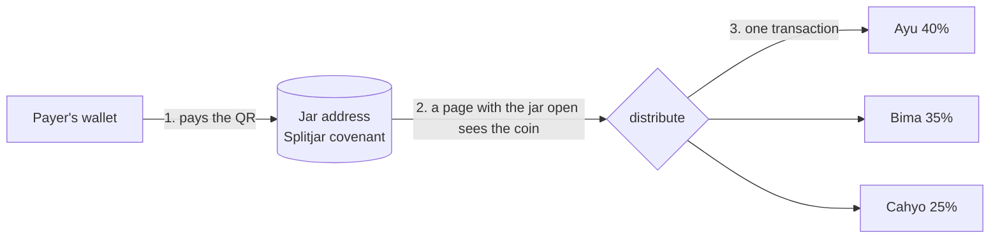

<div align="center">


# Splitjar

**One QR. Everyone gets paid.**

   

**[Open the app](https://splitjar.vercel.app)** · **[Play-money jar, no wallet needed](https://splitjar.vercel.app/try)** · **Slides (Widget Factory): _TODO link_** · **Video: _TODO link_**

</div>

Splitjar is a shared tip jar on Bitcoin Cash. A street band, a warung crew or a group of co-hosts gets one QR code. Every payment to it is split to each member's wallet within seconds, in shares written into a CashScript covenant. Nobody holds the money, so nobody has to be trusted with it.

*Splitjar* is the Indonesian tip tin with a slot in the lid that goes around after a street performance. Afterwards one person always ends up holding it and paying the others back. Splitjar moves that job into the contract.

Built for **BCH BLAZE 2026, Mainnet Track**, November 2026. Contract not audited: use small amounts.


## Try it in 60 seconds

1. **No wallet, no money:** open **[/try](https://splitjar.vercel.app/try)** and press *Drop 0.001 BCH into the tin*. The page runs the real contract against an in-memory network: the split transaction is built by CashScript and checked by the Bitcoin Cash VM (libauth) in your tab. Three member cards light up with their amounts.
2. **Cheat it:** on the same page press *Pay 0.001 BCH and let the thief try first*. Before the honest split, the page broadcasts a transaction that sends the whole payment to the first member. The VM refuses it; the page shows the raw error and the contract line that caught it (`Splitjar.cash` line 32, *one output per member, no extra outputs*). Then the honest split goes through.
3. **Real mainnet:** open the demo jar (_TODO: mainnet demo jar link, set once Dex's member addresses are in_) or make your own at **[/new](https://splitjar.vercel.app/new)** with two to four addresses you control. Scan the QR with any Bitcoin Cash wallet, or press **Pay with WizardConnect** and approve in your wallet. Keep the page open: within a couple of seconds the split goes out and each card links to the transaction on the explorer.


## For judges: how each Mainnet Track requirement is met

| Requirement | How Splitjar meets it | Where to check |
|---|---|---|
| Anyone can make a useful BCH mainnet transaction with the app | Pay into a jar from any wallet (BIP21 QR) or through WizardConnect; the app then broadcasts the split, a second mainnet transaction with one output per member | [`PayPanel.tsx`](src/components/PayPanel.tsx), [`engine.ts`](src/lib/engine.ts). Example mainnet jar and transactions: **TODO** (added after the first funded run) |
| WizardConnect integration | `@wizardconnect/react` 0.2.6 pairs a wallet over the relay; the app derives the wallet's addresses from the shared xpubs, finds its coins, builds the payment with CashScript and asks the wallet to sign it (`inputPaths`) | [`wallet.ts`](src/lib/wallet.ts), [`PayPanel.tsx`](src/components/PayPanel.tsx) |
| Live demo a judge can open with one link | Static site, no account, no backend | https://splitjar.vercel.app |
| Banner on top of the home page: slides, repo, EMBER2026 address | Paper strip above the navigation, filled from one config file | [`Chrome.tsx`](src/components/Chrome.tsx) `Banner`, values in [`site.ts`](src/site.ts) (**slides link and EMBER2026 address: TODO**) |
| Original work | Written from scratch during the hackathon; first commit 17 November 2026 (`git log --reverse`). Prior concept work is listed under [Credits](#credits--prior-work) | git history |

## How it maps to the judging criteria

| Criterion | What Splitjar does |
|---|---|
| **Innovation (is it cool?)** | A tip jar that cannot be cheated, for groups that earn together in cash today. One QR on a guitar case is the whole interface for the payer. The page lets you attack it and shows the network refusing. |
| **Design (is it slick?)** | The payer does what they already know: scan, pay. The group sets up in one form with no account. The tin on screen reacts to real events: a coin drops in when a payment lands, one coin per member flies out when the split is accepted. Mobile first, tested at 360 px. |
| **Technical (does it work?)** | Covenant with native introspection: outputs, amounts, output count and token fields are all fixed by the contract; no owner key, no signature. 26 tests on a mock network that runs the real VM. The split is deterministic, so any number of devices can race to send it and they all send the same transaction. |
| **Business (will it make money?)** | See [Business model](#business-model-and-roadmap): an optional organiser share for events and paid printed QR kits, both without custody. |

## How it works



1. **The group writes down who gets what.** Names, payout addresses and shares (2 to 4 members, shares add up to 100%). That list is encoded in the page link after the `#`, so it never reaches a server. The browser compiles nothing; it instantiates the precompiled contract with these values and gets a P2SH32 address.
2. **Someone pays the QR.** The QR is a BIP21 `bitcoincash:` URI with the amount. WizardConnect is offered for wallets that support it.
3. **The jar splits it.** The page polls the jar address every 1.5 s through an Electrum server. When a coin arrives it builds `distribute()`: one input (the payment), one output per member, amounts computed exactly like the contract computes them. The 1,000-sat fee comes out of the payment, so the page needs no wallet to send it.

Two transactions, payment then split. The contract does not split on arrival (Bitcoin Cash has no such hook); it makes the split the only way the coin can ever move.

## The contract

[`contracts/Splitjar.cash`](contracts/Splitjar.cash), 89 lines, CashScript 0.14.0, compiled to 158 opcodes.

- Constructor (line 9): four locking bytecodes, shares of the first three members in basis points, member count, fee. The last member gets the remainder, so the shares always cover the whole pot.
- `distribute()` (line 27): exactly one input and `members` outputs (lines 31-32); `pot = input - fee` (line 34); each output must pay the right member exactly `floor(pot * bps / 10000)` (lines 36-73), with at least 1,000 sats and no tokens. Integer division floors, and the last member takes what is left, so no satoshi is lost to rounding.
- `merge()` (line 79): joins two coins that are each too small to split. The only output is the jar itself, with the sum minus the fee.

Measured split sizes (mock network, `TransactionBuilder.build`): 441 bytes for 2 members, 502 for 3, 561 for 4, so the fixed 1,000-sat fee pays 1.8 to 2.3 sat/byte, above the 1 sat/byte relay minimum.

**Code map.** Contract arguments from a jar config: [`jar.ts`](src/lib/jar.ts) `contractArgs` (line 125). The split arithmetic shared by the app, the landing page and the tests: `splitPot` (line 41). Transactions: [`chain.ts`](src/lib/chain.ts) `buildDistribute` (line 85), `buildMerge` (line 94), `buildCheat` (line 106), `explainCheat` (line 117). The watcher: [`engine.ts`](src/lib/engine.ts) `JarEngine` (line 61). WizardConnect payment: [`wallet.ts`](src/lib/wallet.ts) `payWithWallet` (line 62).

## Tests

```bash
npm ci
npm test        # compiles the contract, then 26 tests
npm run build   # type-check and production build
```

[`test/splitjar.test.ts`](test/splitjar.test.ts) runs every transaction through CashScript's `MockNetworkProvider`, which evaluates it with the Bitcoin Cash VM against the real locking bytecode, like a node would:

- pays 2, 3 and 4 members their exact shares, the jar ends empty, the fee is exactly 1,000 sats and at least 1 sat/byte;
- rounding: 123,457 sats at 33.33/33.33/33.34% gives 40,814 + 40,814 + 40,829, nothing lost;
- the same split built on two devices has the same bytes and txid; different shares give a different address;
- refuses: the whole pot to one member, an output redirected to someone else with the right amount, swapped amounts, a bigger fee, an extra output, two payments in one split, a payout under 1,000 sats, a merge that leaves the jar, a merge that skims;
- small payments merge and then split.

[`test/jar.test.ts`](test/jar.test.ts) covers the jar link (round trip, broken links), validation (wrong network, address typos, duplicate addresses, shares not adding up) and the arithmetic over 72 amounts.

## Security and honest limits

- **Not audited.** Built in a hackathon week. Use small amounts.
- **Someone has to press split.** The contract only allows the split; a page with the jar open sends it automatically. If nobody has the jar open, the coin waits in the jar, safe, until someone does. Anyone can send it, including from a copy of this repository; the result is the same transaction.
- **Merge griefing is bounded.** Anyone may merge any two coins in the jar; each merge costs the group 1,000 sats and never moves money out. With *n* coins there can be at most *n − 1* merges.
- **Tokens are not supported.** The app shows only the plain (non-token) address. CashTokens sent to the jar anyway are burned when the coin is split.
- **The jar link is public information.** It contains the members' payout addresses and shares, and so does the contract on chain after the first split.
- **WizardConnect coin discovery** checks the first 12 receive and 12 change addresses of the connected wallet. Coins further out are not seen.
- **Fixed fee.** 1,000 sats per split. If relay fee policy ever rose above about 1.7 sat/byte, a new contract version with a higher fee would be needed for 4-member jars.
- **Not yet done (TODO before submission):** a mainnet run with real coins (transaction ids go here), a pairing test with a real WizardConnect wallet.

## Business model and roadmap

- **Free core.** Making a jar and paying into it stays free; the contract has no owner key and takes no cut.
- **Event jars (next):** a fifth, optional output for the organiser of a festival or busking event (for example 0.5%), written into the contract when the jar is made, so performers see it before they agree.
- **Printed kits:** a laminated QR card and a sticker for the tin or guitar case, sold to bands and warung, with the jar link on the back.
- **Roadmap:** a receipt NFT per split (CashTokens), shares in fiat terms at the moment of payment, a watcher that runs without an open page, Indonesian interface.

## Run it locally

Requires Node 22+.

```bash
npm ci
npm run dev       # http://localhost:5173
```

`npm run compile` rebuilds `src/contract/splitjar.artifact.ts` from `contracts/Splitjar.cash` (also run by `dev`, `build` and `test`). The share image is rendered from `scripts/og.html` (`scripts/og.py`), the icons from `public/favicon.svg` (`scripts/icons.mjs`).

## Credits & prior work

- Concept: the split-payment idea was first explored by the same author in **BonBagi** (ZECATHON 2026, Zcash shielded payments, October 2026), which split one payment across members with a signed agreement and a multi-recipient Zcash request. Splitjar shares no code, text or assets with it: the contract, the app and the design were written from scratch for Bitcoin Cash during BCH BLAZE 2026.
- The idea of a covenant that divides coins between fixed recipients has been discussed in the Bitcoin Cash community before (for example "Divide" contracts on the BCH research forum). Splitjar does not claim to be the first; it packages the idea for groups that are paid with a QR.
- Built with [CashScript](https://cashscript.org) 0.14.0 (MIT), [libauth](https://libauth.org) (MIT), [WizardConnect](https://gitlab.com/riftenlabs/lib/wizardconnect) by Riften Labs (LGPL-3.0-or-later, used unmodified as npm packages), [qrcode](https://github.com/soldair/node-qrcode) (MIT), React and Vite. Fonts: Bricolage Grotesque, Instrument Sans and IBM Plex Mono (SIL Open Font License) via Fontsource.
- Logo, tin illustration and share image: drawn for this project.

License: [MIT](LICENSE).
